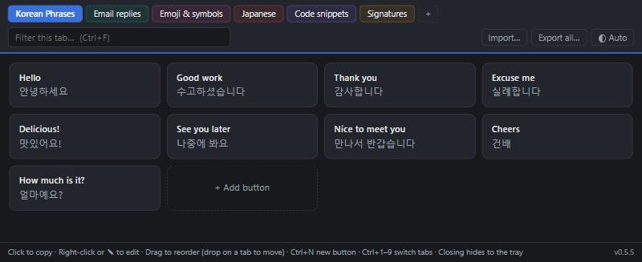
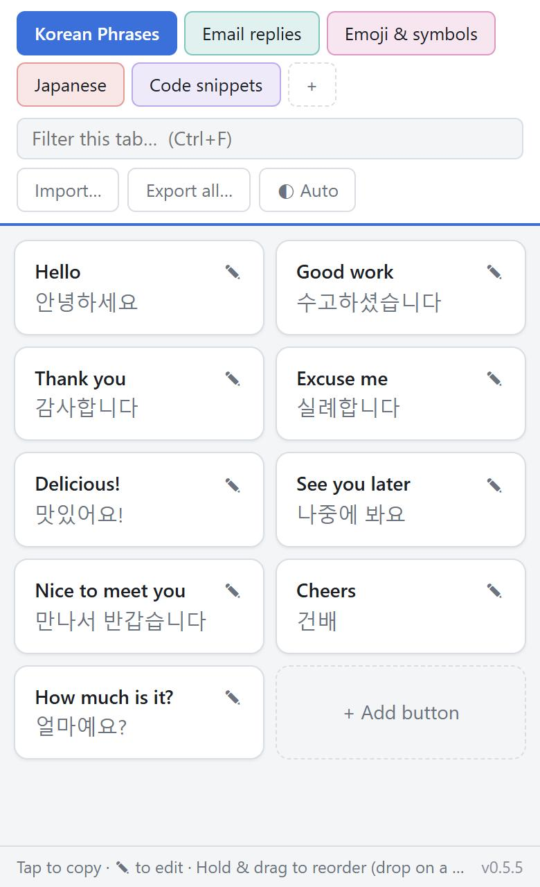

# PhraseShelf

**Tabs of labeled buttons that copy phrases to your clipboard.** Click "Thank you" and 감사합니다 is ready to paste. It's handy for phrases you can't easily type (other languages, emoji, symbols), canned replies, addresses, and code snippets.

<p>
  
  &nbsp;
  
</p>

- **Windows, Linux, Android and the web.** It's one app, with the same look everywhere.
- **Private by design.** There are no accounts, no tracking and no cloud. Your buttons stay on your device. See the [privacy policy](https://phraseshelf.app/privacy).
- **Small and fast.** The installer is about 3 MB, and it starts instantly from the system tray.
- **Import and export** tabs as `.json` to move them between devices or share them, or import a plain `Title -> Content` text list.

## Download

| Platform | Get it |
|---|---|
| **Web** (any browser, installable, works offline) | [phraseshelf.app](https://phraseshelf.app) |
| **Windows** 10/11 | `PhraseShelf_<version>_x64-setup.exe` from [Releases](https://github.com/phraseshelf/phraseshelf/releases/latest) |
| **Android** 7+ (arm64) | `PhraseShelf_<version>_arm64.apk` from [Releases](https://github.com/phraseshelf/phraseshelf/releases/latest) |
| **Linux** | `.AppImage`, `.deb` or `.rpm` from [Releases](https://github.com/phraseshelf/phraseshelf/releases/latest) |

The Windows installer isn't code-signed yet (see the [code signing policy](#code-signing-policy)), so Windows SmartScreen may warn about it. Click **More info → Run anyway**. On Android, allow your browser or file manager to "install unknown apps".

Built with [Tauri 2](https://tauri.app). The Rust backend (`src-tauri/`) handles saving data and the clipboard, and the UI (`ui/`) is plain HTML/CSS/JS with no build step.

## Using it

| Do this | How |
|---|---|
| Copy | Click a button |
| Add a button | **+ Add button** card, or `Ctrl+N` |
| Edit / delete a button | Hover and click **✎**, or right-click it |
| Add a tab | **+** next to the tabs |
| Rename / delete a tab | Double-click or right-click the tab |
| Reorder | Drag buttons or tabs; drop a button on another tab to move it there |
| Filter | `Ctrl+F`, then `Enter` copies the first match, `Esc` clears |
| Switch tabs | `Ctrl+1` … `Ctrl+9` |
| Change a tab's color | Double-click the tab, pick a swatch |
| Export | **Export tab…** in a tab's dialog, or **Export all…** (saves `.json`) |
| Import | **Import…** accepts a `.json` export or a `.txt` list (see below). Imported tabs are always added as new tabs and never overwrite existing ones |

### System tray

Closing the window hides it to the tray. Left-click the tray icon to show or hide it, and right-click it for **Quit**. Starting the app again while it's running just brings the existing window forward.

### Text list import

A plain UTF-8 `.txt` file with one button per line becomes a tab named after the file. Lines without `->` are ignored.

```
Hello -> 안녕하세요
Good work -> 수고하셨습니다
```

## Android

The same app runs on Android:
- Tap a button to copy it. Tap ✎ to edit it.
- To reorder, hold a button or tab until it lifts, then drag it. Drop a button on another tab to move it there (or use the **Tab** picker in its editor).
- Hold a tab still for about a second (or hold it and let go without dragging) to rename it, change its color, or export it.
- Each device keeps its own data. To copy everything across, use **Export all** on one device and **Import** on the other.

## Web version

The same app also runs in a browser, with no install needed:
- Your data is stored only in that browser's local storage on that device, and it is never sent anywhere. Clearing the site's data deletes it, so use **Export all…** to back up.
- It works offline after the first visit, and it can be installed: **Install app** in Chrome/Edge, or **Add to Home Screen** on a phone (iPhone included).
- There's no tray or auto-update, and none is needed: the site is always the latest version.

To build it, run `python scripts/build_web.py`. It writes a static site to `dist/web/` (the shared `ui/` plus `web/`), which can be uploaded to any static host. Releases deploy it to phraseshelf.app automatically as a Cloudflare Worker (see `wrangler.toml`). The version comes from `tauri.conf.json`, and a new version replaces the offline copy the next time the page is opened.

## Installing

Run `PhraseShelf_<version>_x64-setup.exe`. It installs for your Windows account only (no admin needed) and adds a Start menu entry. Uninstall it from Windows Settings → Apps. Your data in `%APPDATA%` is kept.

## Where your data lives

`%APPDATA%\app.phraseshelf\data.json` is plain JSON, so you can back it up or edit it by hand. The previous version is kept beside it as `data.json.bak` on every save.

## Releases and updates

Pushing a version tag (e.g. `v0.6.0`) runs [`.github/workflows/release.yml`](.github/workflows/release.yml). It builds:
- the Windows installer
- Linux packages (`.deb`, `.rpm`, `.AppImage`)
- a signed Android APK

Everything goes into a **draft** GitHub Release, which you review and then publish.

The Windows and Linux (AppImage) apps check the latest release on startup and offer to update. Updates are signed, and the app only installs ones that match the public key in `tauri.conf.json`. You can also click the version number in the footer to check for updates.

## Building

Prerequisites: [Rust](https://rustup.rs) and the Visual Studio C++ Build Tools ("Desktop development with C++"). WebView2 ships with Windows 11.

```powershell
cd src-tauri
cargo run              # debug build, launches the app
cargo build --release  # standalone exe at src-tauri\target\release\phraseshelf.exe
```

For quick UI tweaks without rebuilding, run `python -m http.server 8765` in the repo root and open `http://localhost:8765/dev/preview.html`. It loads `ui/` with a fake backend and sample tabs; nothing is saved.

### Android build

Prerequisites:
- JDK 17, with `JAVA_HOME` set
- The Android SDK, with `ANDROID_HOME` set
- An Android NDK, with `NDK_HOME` set
- The Rust Android targets: `rustup target add aarch64-linux-android armv7-linux-androideabi i686-linux-android x86_64-linux-android`

```powershell
powershell -ExecutionPolicy Bypass -File scripts\build-android.ps1
```

The APK is written to `dist\PhraseShelf-<version>-arm64.apk`. The script works around Windows' symlink restriction. If Windows Developer Mode is on, plain `cargo tauri android build --apk --target aarch64` in `src-tauri` also works, but it produces an unsigned APK that has to be signed before it can be installed. To install it, copy it to the phone and open it (allow "install unknown apps"), or use `adb install <apk>`.

### Windows installer

To build the installer, install the Tauri CLI once with `cargo install tauri-cli --version "^2" --locked`. Then run `cargo tauri build` in `src-tauri`. The installer is written to `src-tauri\target\release\bundle\nsis\`.

## Languages

PhraseShelf is available in **English, Français, Español, Português (Brasil), 한국어 and 日本語**. It follows your system language, and you can override it with the 🌐 picker in the toolbar. On first run, the starter tab is also in your language.

**Help translate:** the translations live in [`ui/i18n/`](ui/i18n/), one JSON file per language. If something reads awkwardly in your language, please open an issue or a pull request. They were written with AI help and haven't all been reviewed by native speakers yet.

To add a language:
1. Copy `ui/i18n/en.json` to `ui/i18n/<code>.json` (for example `it.json` or `zh-TW.json`) and translate the values. Keep `{placeholders}` as they are. Entries with `one`/`other` are plural forms; use the forms your language needs (`zero`, `one`, `two`, `few`, `many`, `other`).
2. Add the language to `LANGUAGES` in [`ui/i18n.js`](ui/i18n.js).
3. Run `python scripts/check_i18n.py`, which lists anything missing or mistyped. CI runs it too.

## Code signing policy

Free code signing provided by [SignPath.io](https://about.signpath.io), certificate by [SignPath Foundation](https://signpath.org).

- Committers and reviewers: [Members](https://github.com/orgs/phraseshelf/people)
- Approvers: [Owners](https://github.com/orgs/phraseshelf/people?query=role%3Aowner)

Windows installers are built only by the [release workflow](.github/workflows/release.yml) from the tagged source in this repository, and each signing request is approved by hand. Only PhraseShelf's own binaries are signed.

**Privacy:** This program will not transfer any information to other networked systems unless specifically requested by the user or the person installing or operating it. The one exception is the desktop update check, which contacts GitHub and sends no personal data. See the full [privacy policy](https://phraseshelf.app/privacy).

## License

[MIT](LICENSE)
